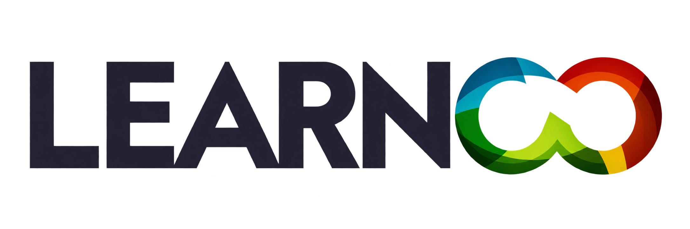
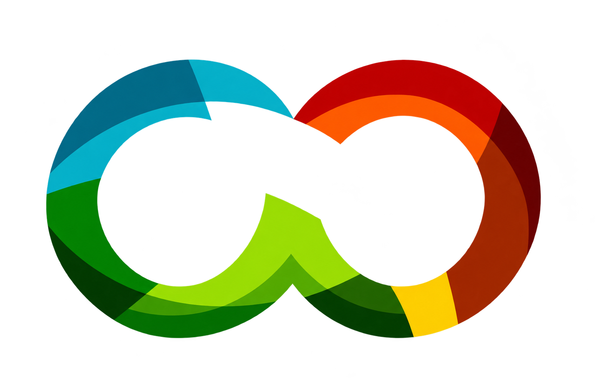

# Learnoo logo assets

Use the complete wordmark for placements that need the Learnoo name. Use the standalone colourful OO symbol for compact placements.

| Asset | Purpose |
| --- | --- |
| [Full wordmark](learnoo-wordmark-recreated.png) | LEARN lettering followed by the colourful OO symbol; transparent PNG, 2172 × 724 |
| [Compact symbol](learnoo-symbol-recreated.png) | Standalone colourful OO symbol; transparent PNG, 1568 × 1003 |

These raster reconstructions follow the maintainer's supplied original banner and requested wordmark structure. They are not vector masters. Preserve their proportions and colours. The full wordmark has dark lettering intended for light backgrounds. Keep the original supplied reference unchanged wherever it is stored; these files are separate assets.

These files do not change the project's brand reuse policy. See the [license notice](../../LICENSE.md) and [licensing notes](../../docs/LICENSING.md).

## Full wordmark

## Compact symbol

